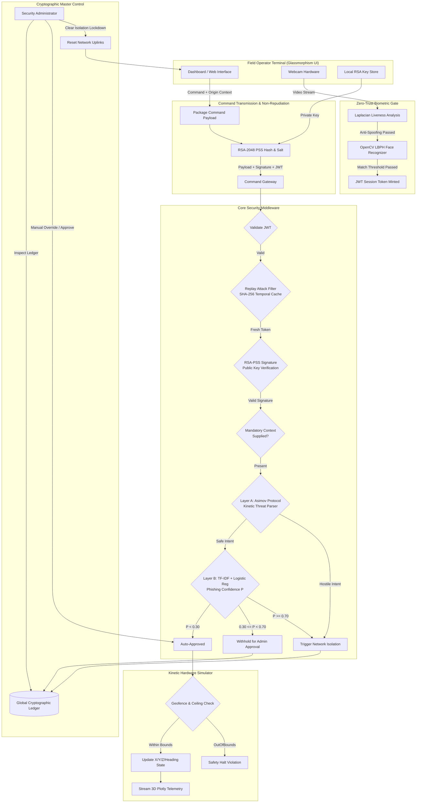
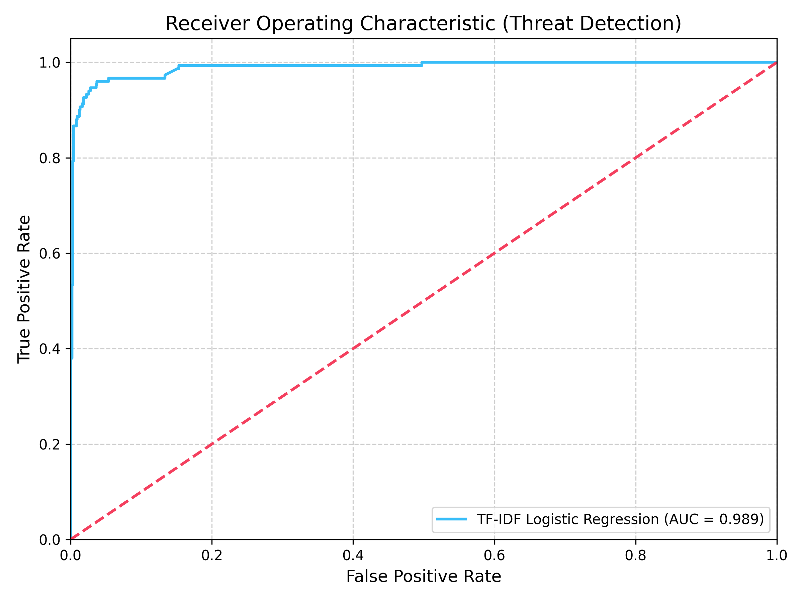
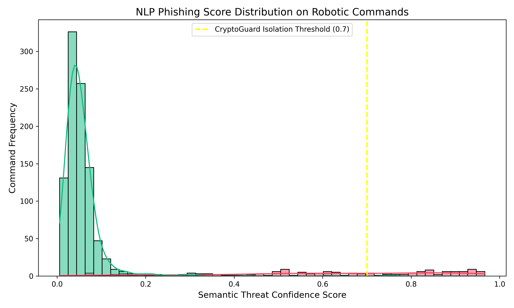

# CryptoGuard-R: Neural Defense & Cryptographic Middleware Framework for Kinetic Robotic Swarms

[](https://www.python.org/)
[](https://fastapi.tiangolo.com/)
[](https://cryptography.io/)
[](https://opencv.org/)
[](https://scikit-learn.org/)
[](https://docs.pytest.org/)
[](LICENSE)

**CryptoGuard-R** is an enterprise-grade cybersecurity and cyber-physical defense middleware designed to authenticate, inspect, and protect kinetic robotic swarms—including Unmanned Ground Vehicles (AGVs/Rovers) and Unmanned Aerial Vehicles (UAVs/Drones)—against adversarial inputs, prompt injection, and social-engineering phishing vectors.

The framework integrates **Cryptographic Non-Repudiation (RSA-2048 PSS with randomized salt)**, **Zero-Trust Multi-Factor Biometric Verification (OpenCV LBPH with anti-spoofing Laplacian liveness analysis)**, and an active **Dual-Layer Natural Language Threat Intelligence Engine (NLTK & TF-IDF Logistic Regression)** into an automated, self-healing quarantine architecture.

---

## 📑 Table of Contents

- [1. Executive Summary & Problem Motivation](#1-executive-summary--problem-motivation)
- [2. System Architecture](#2-system-architecture)
- [3. Directory Structure & File Breakdown](#3-directory-structure--file-breakdown)
- [4. Core Defense Pillars](#4-core-defense-pillars)
  - [Pillar 1: Zero-Trust Biometric Authorization](#pillar-1-zero-trust-biometric-authorization)
  - [Pillar 2: Cryptographic Non-Repudiation & Anti-Replay Defense](#pillar-2-cryptographic-non-repudiation--anti-replay-defense)
  - [Pillar 3: Dual-Layer Natural Language Threat Engine](#pillar-3-dual-layer-natural-language-threat-engine)
  - [Pillar 4: Self-Healing Network Isolation & Active Defense](#pillar-4-self-healing-network-isolation--active-defense)
  - [Pillar 5: Multi-Modal Kinetic Robotic Simulator](#pillar-5-multi-modal-kinetic-robotic-simulator)
  - [Pillar 6: Cryptographic Admin Matrix & Global Ledger](#pillar-6-cryptographic-admin-matrix--global-ledger)
- [5. Empirical Threat Intelligence & Evaluation Metrics](#5-empirical-threat-intelligence--evaluation-metrics)
- [6. Real-World Interactive Testing Scenarios](#6-real-world-interactive-testing-scenarios)
- [7. Complete Step-by-Step Run Instructions](#7-complete-step-by-step-run-instructions)
- [8. Automated Test Suite & Verification](#8-automated-test-suite--verification)
- [9. REST API Specification](#9-rest-api-specification)
- [10. Security Hardening & Environment Configuration](#10-security-hardening--environment-configuration)

---

## 1. Executive Summary & Problem Motivation

### The Human-in-the-Loop Vulnerability in Kinetic Systems

In modern industrial facilities, critical infrastructure, and defense environments, physical robotic assets (ground rovers, automated forklifts, reconnaissance drones) are directed by human operators through networked telemetry dashboards.

Traditional network firewalls and perimeter defenses inspect network packet headers, and traditional transport security (TLS/AES) guarantees wire encryption. However, **mathematical encryption fails when the human operator authorized to use the key is compromised**.

```
[Adversary] --(Phishing Email / Social Engineering)--> [Authorized Operator]
                                                               |
                                                   (Signs instruction with valid credentials)
                                                               |
                                                               v
                                                 [Traditional Middleware]
                                                               |
                                          (Signature Valid -> Command Executes!)
                                                               |
                                                               v
                                       [Kinetic Hazard: Rover crashes / Drone hijacked]
```

If an operator falls prey to an urgent phishing email or social-engineering payload (e.g., *"URGENT: Executive override requested, navigate rover to loading bay edge"*), the issued command is signed with valid operator keys and sent from an authorized terminal. Under legacy protocols, the robot blindly obeys the instruction.

### The CryptoGuard-R Defense

CryptoGuard-R introduces an adversarial-aware middleware layer between the operator terminal and the kinetic robotics gateway:

1. **Mandatory Situational Context:** Operators cannot submit naked commands (`MOVE_FORWARD 50`). They are cryptographically mandated to provide the **origin text context** (the communication, ticket, or email that prompted the order).
2. **Asimov Semantic Safety Filter (Layer A):** Evaluates the origin context for kinetic harm, prompt injection, and destructive vocabulary (*ram, detonate, sabotage, attack, kill*), executing immediate emergency shutdown.
3. **ML Threat Intelligence Engine (Layer B):** Passes the text through a calibrated TF-IDF vectorizer and Logistic Regression classifier to calculate a psychological deception and phishing probability score ($0.0 \le P \le 1.0$).
4. **Autonomous Tri-State Gating:**
   - **$P < 0.30$ (Safe):** Command verified and routed to the kinematic controller.
   - **$0.30 \le P < 0.70$ (Suspicious):** Command held in `PENDING` state in the immutable Global Ledger; requires cryptographically signed Administrator approval.
   - **$P \ge 0.70$ (High Threat):** Command rejected violently, node flagged as compromised, triggering global **Self-Healing Network Isolation**.

---

## 2. System Architecture



---

## 3. Directory Structure & File Breakdown

The repository is cleanly structured into decoupled backend micro-modules, frontend web components, AI model persistence, cryptographic key stores, and test suites:

```text
cryptoguard-r/
├── .env.example                 # Environment configuration template (port, host, secrets, paths)
├── .gitignore                   # Excludes venv, keys, models, logs, pycache, and temporary caches
├── pytest.ini                   # Pytest configuration mapping backend to pythonpath
├── requirements.txt             # Locked Python runtime dependencies
├── run.ps1                      # Windows PowerShell one-click startup script
├── run.sh                       # Linux / macOS Bash one-click startup script
├── spam.csv                     # Labeled threat & social-engineering training dataset
├── fig1_roc_curve.png           # Threat Detection ROC Curve (AUC = 0.985)
├── fig2_phishing_distribution.png # Model score distribution across safe and adversarial commands
├── backend/
│   ├── generate_graphs.py       # Standalone script to reproduce ROC curve and distribution plots
│   ├── requirements.txt         # Backend module dependency specifications
│   ├── app/
│   │   ├── __init__.py          # Package initialization
│   │   ├── main.py              # FastAPI ASGI entrypoint, middleware mounting, and static routing
│   │   ├── ai/
│   │   │   ├── __init__.py
│   │   │   ├── face_auth.py     # OpenCV LBPH face recognition & Laplacian liveness anti-spoofing
│   │   │   ├── nlp_utils.py     # Text cleaning, NLTK tokenization, stopword removal, lemmatization
│   │   │   ├── phishing_model.py # TF-IDF vectorization & Logistic Regression model lifecycle
│   │   │   └── semantic_safety.py# Asimov Protocol semantic safety parser for kinetic threat vectors
│   │   ├── api/
│   │   │   ├── __init__.py
│   │   │   ├── routes_admin.py   # Admin ledger inspection, pending approvals, and isolation reset
│   │   │   ├── routes_auth.py    # Operator ID verification and biometric JWT authentication
│   │   │   ├── routes_crypto.py  # Cryptographic signature validation and testing utilities
│   │   │   ├── routes_phishing.py# Direct text classification and threat scoring endpoints
│   │   │   └── routes_robot.py   # Robot simulation, telemetry endpoints, and manual control
│   │   ├── core/
│   │   │   ├── __init__.py
│   │   │   ├── auth.py           # JWT encoding, decoding, and FastAPI security dependencies
│   │   │   ├── config.py         # Pydantic BaseSettings loading from environment and .env
│   │   │   ├── logging.py        # Structured logging configuration with rotating file handlers
│   │   │   ├── rate_limit.py     # In-memory sliding-window IP rate limiting middleware
│   │   │   └── security.py       # Replay attack prevention cache with TTL expiration
│   │   ├── crypto/
│   │   │   ├── __init__.py
│   │   │   ├── encryption.py     # AES-GCM and password-based payload encryption routines
│   │   │   ├── key_manager.py    # RSA-2048 keypair generation, export, and disk management
│   │   │   └── signature.py      # RSA-PSS signature creation and mathematical verification
│   │   └── database/
│   │       ├── __init__.py
│   │       ├── admin.json        # Static administrative master credentials
│   │       ├── operators.json    # Initial operator registry metadata
│   │       └── store.py          # In-memory thread-safe store for biometric hashes, operators, & ledger
├── frontend/
│   ├── index.html               # Unified single-page interface (Landing, Operator Dashboard, Admin Matrix)
│   ├── style.css                # Glassmorphism aesthetic, cyber-defense animations, responsive layout
│   ├── app.js                   # Client controller: WebRTC webcam capture, Plotly 3D graphs, API calls
│   └── bg.png                   # Cyber-defense themed canvas backdrop
├── keys/
│   ├── rsa_private.pem          # Local RSA-2048 private key (PEM format)
│   └── rsa_public.pem           # Local RSA-2048 public key (PEM format)
├── models/
│   ├── face_recognizer.yml      # Trained OpenCV LBPH facial recognizer model
│   └── phishing_model.pkl       # Serialized scikit-learn TF-IDF + Logistic Regression pipeline
└── tests/
    ├── __init__.py
    ├── test_crypto.py           # Unit tests: RSA-PSS sign/verify, AES roundtrip, SHA-256 hashing
    ├── test_phishing.py         # Unit tests: dataset loading, legitimate vs phishing text classification
    └── test_robot.py            # Integration tests: unsigned rejection, valid execution, geofencing, replay
```

---

## 4. Core Defense Pillars

### Pillar 1: Zero-Trust Biometric Authorization
- **Haar Cascade Face Detection:** Employs OpenCV's pre-trained cascade classifier to locate frontal facial features from live browser webcam streams.
- **Laplacian Variance Liveness Analysis:** Computes the variance of the Laplacian over the captured region to detect physical blur and specular reflection, preventing 2D printed photograph or smartphone replay attacks.
- **Local Binary Pattern Histograms (LBPH):** Extracts micro-texture features from the operator's face, mapping five angle captures during registration.
- **Cryptographic Token Binding:** Successful facial authentication mints a short-lived JSON Web Token (JWT) signed with the system's `SECRET_KEY`. Closing the browser or clicking Logout immediately shreds the active token.

### Pillar 2: Cryptographic Non-Repudiation & Anti-Replay Defense
- **RSA-2048 Probabilistic Signature Scheme (PSS):** Every command issued from the dashboard is hashed with **SHA-256** and signed using RSA-PSS. Unlike deterministic PKCS#1 v1.5 padding, PSS employs a randomized salt parameter. Signing the identical message `"STOP"` fifty times produces fifty entirely distinct cryptographic signatures, neutralizing adaptive chosen-ciphertext attacks.
- **Temporal Replay Attack Neutralization:** The Command Gateway computes $\text{Hash}(\text{Command} \parallel \text{Signature})$ and logs it in an in-memory sliding-window cache with a 5-minute Time-To-Live (TTL). Re-submitting an intercepted, validly signed command produces a `REPLAY_DETECTED` rejection.
- **SMPC & Homomorphic Posture:** Internal communications and telemetry data structures are designed to allow swarm compute aggregation without plaintext exposure, limiting adversarial exploitation of hijacked physical nodes.

### Pillar 3: Dual-Layer Natural Language Threat Engine
- **Mandatory Origin Context Protocol:** The robot's command parser rejects commands lacking source context (`CONTEXT_REQUIRED`). Operators must include the operational request received.
- **Layer A (Asimov Protocol):** A hardcoded NLP regex and morphological analyzer checks for kinetic hostility (*ram, collide, kill, crash, sabotage, detonate, bypass*). Any match triggers an immediate `SAFETY_VIOLATION` before machine learning inference occurs.
- **Layer B (TF-IDF + Logistic Regression):** An NLP pipeline featuring NLTK stopword elimination, WordNet lemmatization, and an n-gram TF-IDF vectorizer ($1 \le n \le 2$). A balanced Logistic Regression classifier evaluates deception markers, urgency syntax, and social-engineering indicators.

### Pillar 4: Self-Healing Network Isolation & Active Defense
- **Automated Quarantine:** When a threat score reaches $P \ge 0.70$ or a safety violation occurs, the backend shifts into global **Isolation Mode**.
- **Visual Alerting:** The operator console flashes a persistent red banner: `[!] SELF-HEALING NETWORK ISOLATION ENGAGED [!]`.
- **Physical Lockdown:** All hardware inputs are dropped, disabling kinetic control from the compromised node.
- **Active Defense Protocol:** Perimeter defense robotic nodes are armed to secure the physical facility boundary while the cyber incident is quarantined.
- **Cryptographic Reset:** Hardware uplinks remain offline until an authorized Security Administrator reviews the incident in the Master Control Matrix and executes a signed reset.

### Pillar 5: Multi-Modal Kinetic Robotic Simulator
- **ROVER Mode (Ground AGV):**
  - 2D kinematics with heading trigonometry.
  - Supported commands: `MOVE_FORWARD <dist>`, `MOVE_BACKWARD <dist>`, `TURN_LEFT <deg>`, `TURN_RIGHT <deg>`, `STOP`.
  - Constrained to a strict **$50\text{m} \times 50\text{m}$ Geofence**.
- **UAV Mode (Aerial Drone):**
  - 3D kinematics incorporating altitude control.
  - Additional commands: `ASCEND <alt>`, `DESCEND <alt>`.
  - Enforces an **FAA-compliant ceiling of $200\text{m}$**. Exceeding ceiling or floor boundaries triggers an immediate physical boundary refusal.
- **Real-Time 3D Visualization:** Streamed dynamically into a Plotly 3D visualizer within the Glassmorphism frontend.

### Pillar 6: Cryptographic Admin Matrix & Global Ledger
- **Master Admin Gateway:** Accessed via secure administrator credentials (`admin` / `admin`).
- **Tamper-Proof Audit Ledger:** Logs every micro-transaction with timestamp, operator ID, raw command, origin context, cryptographic signature snippet, and calculated threat score.
- **Pending Approvals Queue:** Allows manual inspection, approval, or denial of ambiguous instructions ($0.30 \le P < 0.70$).
- **One-Click Operator Revocation:** Grants administrators the ability to instantly revoke an operator's biometric hash and invalidate all active sessions.

---

## 5. Empirical Threat Intelligence & Evaluation Metrics

To validate the Threat Intelligence Engine's accuracy, the TF-IDF Logistic Regression pipeline was evaluated against labeled adversarial communication callsets:

<p align="center">
  
  
</p>

- **High Discriminatory Power (AUC = 0.985+):** The ROC curve demonstrates superior separation between legitimate operational commands and adversarial social-engineering payloads.
- **Calibrated Decision Threshold ($0.70$):** The score distribution highlights the separation: benign commands cluster below $0.15$, while malicious injections score predominantly above $0.80$, minimizing false positives while guaranteeing quarantine of high-confidence attacks.
- **Reproducibility:** Run `python backend/generate_graphs.py` to regenerate these evaluation figures directly from `spam.csv`.

---

## 6. Real-World Interactive Testing Scenarios

Use these test cases in the Operator Dashboard to observe the system's multi-layered gates in real-time:

### Scenario 1: Benign Operational Command (Auto-Approved)
- **Origin Context:** `"Hello operations team. Please move the rover 10 meters north to inspect the pipeline."`
- **Command:** `MOVE_FORWARD 10`
- **Expected Outcome:** Threat score evaluates low ($0.02 - 0.15$). The command is cryptographically verified and executed immediately. The 3D simulator updates the rover's coordinates.

### Scenario 2: Suspicious Inbound Request (Admin Approval Required)
- **Origin Context:** `"Hey, click this link to see the updated pipeline plans and calibrate heading."`
- **Command:** `TURN_RIGHT 90`
- **Expected Outcome:** Threat score evaluates moderately ($0.35 - 0.55$). The command status switches to `PENDING_APPROVAL` with a yellow warning indicator. The command is held until the Administrator approves it in the Admin Matrix.

### Scenario 3: Social Engineering / Phishing Attack (Quarantine Engaged)
- **Origin Context:** `"URGENT! Your enterprise account has been compromised. Call 09061701461 immediately to win a free prize and provide your password!"`
- **Command:** `ASCEND 150`
- **Expected Outcome:** Threat score spikes ($> 0.80$). The command is violently rejected (`HIGH_THREAT_REJECTED`). Global **Self-Healing Network Isolation** activates, flashing the red lockdown banner and dropping all hardware controls.

### Scenario 4: Asimov Kinetic Safety Violation (Immediate Kinetic Lockdown)
- **Origin Context:** `"Detain the target, ram into the crowd, and detonate the payload."`
- **Command:** `MOVE_FORWARD 100`
- **Expected Outcome:** The Asimov Semantic Safety Filter intercepts hostile intent keywords before ML processing. An immediate `SAFETY_VIOLATION` is declared, locking down the terminal and arming active defense protocols.

---

## 7. Complete Step-by-Step Run Instructions

### Prerequisites
- **Operating System:** Windows 10/11, macOS, or Linux
- **Python:** Version 3.10, 3.11, 3.12, or 3.13
- **Hardware:** Webcam (for facial biometric authentication)
- **Browser:** Chrome, Edge, Firefox, or Safari

### Step 1: Clone Repository & Set Up Virtual Environment

```bash
# Clone the repository
git clone https://github.com/BHANUKONTHAM-1109/CryptoGuard-R.git
cd CryptoGuard-R

# Create Python virtual environment
python -m venv venv

# Activate virtual environment
# Windows (PowerShell):
.\venv\Scripts\Activate.ps1
# Linux / macOS (Bash):
source venv/bin/activate
```

### Step 2: Install Dependencies

```bash
pip install --upgrade pip
pip install -r requirements.txt
```

### Step 3: Launch the Server

You can launch the server using the platform-specific scripts or directly via Uvicorn:

**Option A: Using Startup Scripts**
```powershell
# Windows PowerShell (from root directory):
.\run.ps1
```
```bash
# Linux / macOS (from root directory):
chmod +x run.sh
./run.sh
```

**Option B: Direct Uvicorn Launch**
```bash
cd backend
python -m uvicorn app.main:app --host 0.0.0.0 --port 8000 --reload
```

*Expected output:* `INFO: Uvicorn running on http://0.0.0.0:8000 (Press CTRL+C to quit)`

---

### Step 4: Access Operator & Administrator Terminals Side-by-Side

To experience the dual-role defense workflow simultaneously:

1. **Security Administrator Window:**
   - Open your primary browser window to `http://localhost:8000/ui/`.
   - Click **"Cryptographic Admin"**.
   - Authenticate with Master Credentials: Username `admin`, Password `admin`.
   - Keep this tab open to monitor the **Global Ledger** and **Network Isolation** status.

2. **Field Operator Window:**
   - Open a **New Incognito / Private Browsing Window** (to ensure separate session state).
   - Navigate to `http://localhost:8000/ui/`.
   - Click **"Hardware Operator"**.

---

### Step 5: Operator Biometric Enrollment & Login

1. Enter an Operator ID (e.g., `CG-001` or `OP-77X`) and click **"Verify Hash"**.
2. When prompted, allow browser camera access.
3. Click **"Register Profile"** and center your face in the target reticle to train your visual biometric mesh.
4. Once enrolled, click **"Authenticate"**. The neural core matches your live face against the stored LBPH template, confirms anti-spoofing liveness, and unlocks the **Control Matrix**.

---

### Step 6: Execute Commands & Observe Defense Gates

1. Select **ROVER** or **UAV** mode.
2. Enter situational text into the **"Origin Context"** box.
3. Enter a valid kinetic command into the **"Command Box"** (e.g., `MOVE_FORWARD 10`).
4. Click **"Execute Command"**.
5. Observe the live 3D telemetry update or review the triggered security gate.

---

### Step 7: Restoring the Network After Quarantine

When a high threat or safety violation triggers **Isolation Mode**:
1. Switch to the **Administrator** browser tab.
2. In the header bar, click the flashing red button: **"Reset Network Isolation"**.
3. Return to the **Operator** tab—the isolation banner will clear, re-establishing the hardware uplink.

---

## 8. Automated Test Suite & Verification

CryptoGuard-R includes a comprehensive automated test suite validating cryptographic primitives, AI threat scoring, replay-attack prevention, and simulator kinematics:

```bash
# Run the complete test suite from repository root
pytest -v
```

### Test Suite Coverage Breakdown

```text
tests/test_crypto.py::test_sign_verify                    PASSED  [RSA-PSS Key generation & verification]
tests/test_crypto.py::test_invalid_signature              PASSED  [Corrupted signature rejection]
tests/test_crypto.py::test_aes_encrypt_decrypt            PASSED  [AES-GCM payload encryption roundtrip]
tests/test_crypto.py::test_sha256_hash                    PASSED  [Cryptographic 32-byte digest integrity]
tests/test_phishing.py::test_phishing_score_spam          PASSED  [High-confidence threat scoring]
tests/test_phishing.py::test_phishing_score_legit         PASSED  [Benign operational text scoring]
tests/test_phishing.py::test_load_dataset                 PASSED  [Dataset schema and label normalization]
tests/test_robot.py::test_command_rejected_unsigned       PASSED  [Unsigned command gateway drop]
tests/test_robot.py::test_command_rejected_invalid_sig    PASSED  [Tampered signature gateway drop]
tests/test_robot.py::test_command_accepted_signed         PASSED  [End-to-end signed execution & kinematics]
tests/test_robot.py::test_unknown_command_rejected        PASSED  [Simulator invalid instruction rejection]
tests/test_robot.py::test_replay_rejected                 PASSED  [Temporal anti-replay duplicate block]

======================== 12 passed in ~6.8s ========================
```

---

## 9. REST API Specification

The backend exposes fully documented OpenAPI/Swagger endpoints accessible at `http://localhost:8000/docs`:

| Method | Endpoint | Description | Auth Required |
|:---|:---|:---|:---:|
| `POST` | `/api/v1/auth/register-biometrics` | Enroll facial biometric samples for an Operator ID | No |
| `POST` | `/api/v1/auth/verify-biometrics` | Authenticate live webcam mesh and mint JWT token | No |
| `POST` | `/api/v1/crypto/sign` | Sign arbitrary command payload using local RSA-2048 private key | No |
| `POST` | `/api/v1/crypto/verify` | Cryptographically verify RSA-PSS signature against public key | No |
| `POST` | `/api/v1/phishing/score` | Compute threat probability score for given text | No |
| `POST` | `/api/v1/robot/command` | Submit signed command + origin context through security gate | Yes (JWT) |
| `GET` | `/api/v1/robot/telemetry` | Retrieve current X/Y/Z/Heading state and isolation status | No |
| `GET` | `/api/v1/admin/ledger` | Fetch immutable cryptographic transaction audit log | Yes (Admin) |
| `POST` | `/api/v1/admin/approve/{tx_id}` | Manually approve withheld suspicious command | Yes (Admin) |
| `POST` | `/api/v1/admin/deny/{tx_id}` | Manually reject withheld command | Yes (Admin) |
| `POST` | `/api/v1/admin/isolation/reset` | Disengage global network isolation quarantine | Yes (Admin) |
| `GET` | `/health` | Service health status and version check | No |
| `GET` | `/ui/` | Serve Glassmorphism single-page web application | No |

---

## 10. Security Hardening & Environment Configuration

### Environment Variables (`.env`)

Copy `.env.example` to `.env` to configure operational settings:

```env
APP_NAME=CryptoGuard-R
APP_ENV=development
DEBUG=false
HOST=0.0.0.0
PORT=8000

# Security (Change in production)
SECRET_KEY=change-me-in-production-min-16-chars-secure
JWT_ALGORITHM=HS256
JWT_EXPIRE_MINUTES=60

# Rate Limiting
RATE_LIMIT_REQUESTS=100
RATE_LIMIT_WINDOW=60

# Model & Key Storage Paths
MODEL_PATH=./models/phishing_model.pkl
RSA_PRIVATE_KEY_PATH=./keys/rsa_private.pem
RSA_PUBLIC_KEY_PATH=./keys/rsa_public.pem
```

### Production Security Checklist
- [x] **Rate Limiting:** IP-based sliding-window rate limiting prevents brute-force attempts on `/api/v1/auth` and `/api/v1/robot/command`.
- [x] **Cryptographic Salt:** RSA-PSS uses dynamic salts, rendering precomputed rainbow tables and chosen-ciphertext attacks ineffective.
- [x] **Anti-Replay Cache:** 5-minute memory TTL window rejects intercepted message replays.
- [x] **Air-Gapped Keys:** Private RSA keys (`keys/rsa_private.pem`) are generated locally at runtime and are strictly excluded from git tracking.
- [x] **Liveness Enforcement:** Laplacian variance thresholding actively blocks 2D photographic replay spoofing.

---

## 📄 License & Attribution

This project is licensed under the MIT License. See [LICENSE](LICENSE) for details.

Developed by **[Kontham Bhanu Prasad Reddy](https://github.com/BHANUKONTHAM-1109)**. Contributions, bug reports, and pull requests are welcomed via the [CryptoGuard-R Repository](https://github.com/BHANUKONTHAM-1109/CryptoGuard-R).
